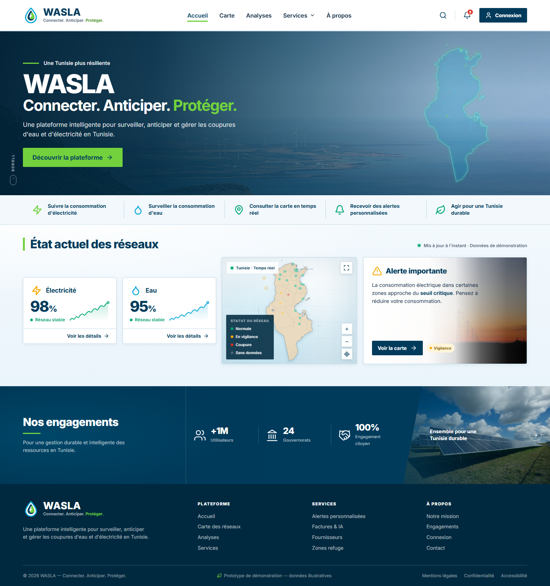
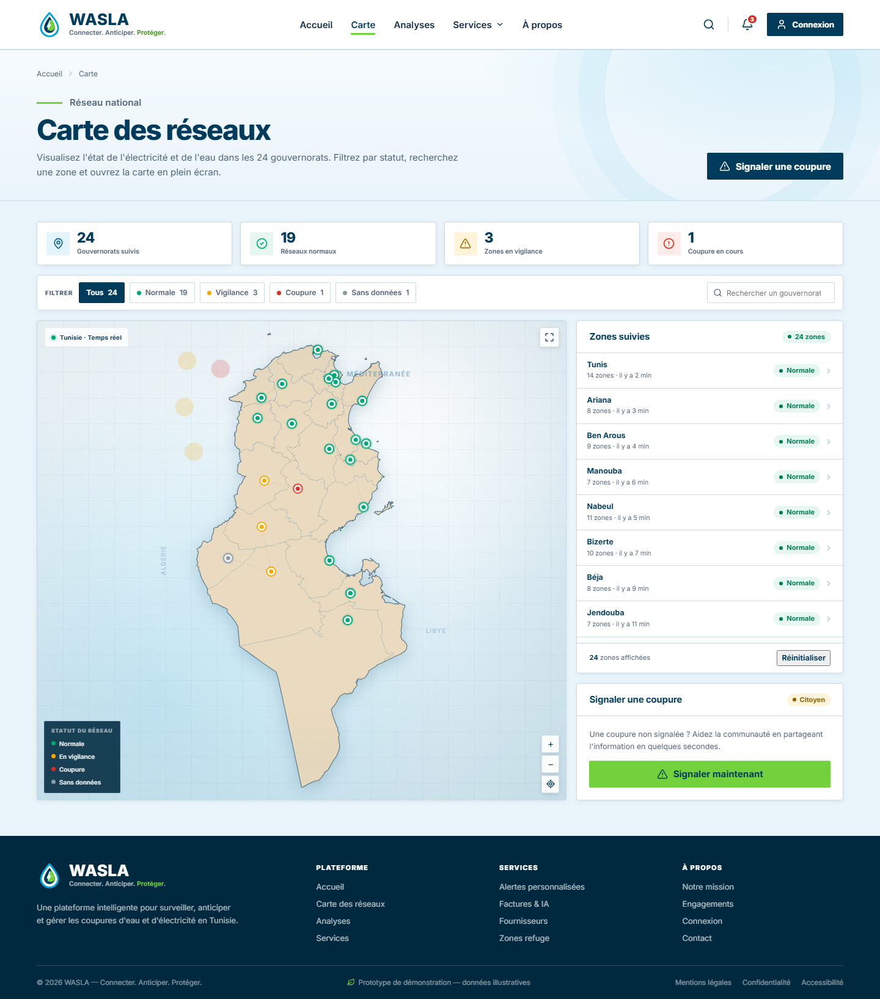
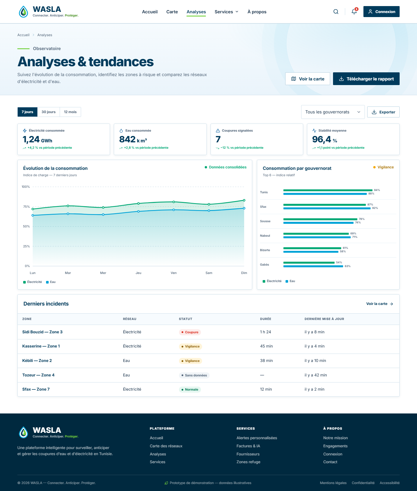

# WASLA – Connecter. Anticiper. Protéger.

Plateforme web pour **surveiller, anticiper et gérer les coupures d'eau et d'électricité en Tunisie**, développée à **Esprit School of Engineering** dans le cadre du Projet Technologies Web (2A, 2026–2027).



## Table des matières

- [Overview](#overview)
- [Features](#features)
- [Tech Stack](#tech-stack)
- [Architecture](#architecture)
- [Contributors](#contributors)
- [Academic Context](#academic-context)
- [Getting Started](#getting-started)
- [Usage](#usage)
- [Contributions](#contributions)
- [Acknowledgments](#acknowledgments)
- [Licence](#licence)

## Overview

This project was developed as part of the **Web Technologies Project – 2nd Year Engineering Program** at **Esprit School of Engineering** (Academic Year 2026–2027).

**Le problème.** En Tunisie, les coupures d'eau et d'électricité, qu'elles soient planifiées ou imprévues, sont souvent mal annoncées. Les citoyens ne savent ni quand elles commencent, ni quand elles finissent, ni où trouver de l'aide.

**La solution.** WASLA réunit sur une même plateforme :

- les **interruptions** publiées par les opérateurs (STEG pour l'électricité, SONEDE pour l'eau) et les **signalements** des citoyens, affichés sur une carte des 24 gouvernorats ;
- des **alertes** envoyées aux habitants des zones touchées ;
- l'**analyse des factures** et de la consommation de chaque citoyen ;
- des **Refuge Zones**, lieux proposés par des entreprises pour accéder à l'eau ou à l'électricité pendant une coupure ;
- un réseau de **solidarité** : demandes d'assistance, bénévoles, propriétaires d'installations solaires et fournisseurs.

Le site comprend un **Front Office** pour les citoyens et les professionnels, et un **Back Office** pour l'administrateur et les sous-admins STEG / SONEDE.

## Features

| Module | Responsable | Fonctionnalités principales | Entités |
|---|---|---|---|
| **1 — Interruptions, signalements & alertes** | Houssem Belhaj | Carte des interruptions (filtre par ressource), signalement d'une coupure, confirmation d'un signalement, publication et clôture des interruptions (STEG / SONEDE), modération, alertes d'urgence, zones géographiques | Interruption, Signalement, Alerte, Confirmation, Zone |
| **2 — Analyse des factures & consommation** | Hiba Bouzid | Inscription, connexion, profil, gestion des factures, relevés de consommation, comparaison avec la moyenne de la zone, analyse d'une facture (anomalies, recommandations) | Facture, Consommation, AnalyseFacture |
| **3 — Refuge Zones** | Louay Azzabi | Recherche et détail d'une Refuge Zone, réservation d'une place, gestion de l'entreprise et de ses refuges, validation par l'administrateur (matricule fiscal) | Entreprise, RefugeZone, ReservationRefuge |
| **4 — Assistance d'urgence, solaire & fournisseurs** | Bechir Hellali | Demande d'assistance, prise en charge par un bénévole, réponse d'un fournisseur ou d'un propriétaire d'installation solaire, annuaire des fournisseurs et de leurs services | DemandeAssistance, Reponse, Fournisseur, Service, InstallationSolaire |

Tables partagées par les 4 modules : **Utilisateur**, dont le rôle est une valeur de la colonne `role` (citoyen, admin, steg, sonede, professionnel, fournisseur, bénévole, propriétaire), et **Notification**.

**Interface :**

- Front Office en **français, anglais et arabe** (mise en page de droite à gauche pour l'arabe) ;
- **thème clair / sombre** ;
- recherche globale (`Ctrl+K`) ;
- responsive (testé de 390 à 1440 px) ;
- accessibilité : navigation au clavier, `aria-*`, contrastes renforcés ;
- Back Office : tableau de bord (indicateurs, graphiques), listes avec recherche et filtres, formulaires avec contrôle de saisie en JavaScript.

| Carte des réseaux | Analyses |
|---|---|
|  |  |

> **État actuel.** Les interfaces sont intégrées dans l'architecture MVC. L'**inscription, la connexion, la déconnexion et l'accès au Back Office** utilisent la base de données (table `utilisateur`) ; les autres modules affichent encore des **données de démonstration**.

## Tech Stack

### Frontend

- HTML5, CSS3 (variables CSS, propriétés logiques pour l'arabe), JavaScript (ES6, sans framework)
- Icônes SVG [Lucide](https://lucide.dev), graphiques SVG faits maison
- Polices Inter et IBM Plex Sans Arabic (hébergées localement)

### Backend

- PHP 8 — architecture **MVC** sans framework (routeur, contrôleurs, layouts, partials)
- MySQL — prévu pour le CRUD (modèle relationnel décrit dans [docs/dictionnaire-entites.docx](docs/dictionnaire-entites.docx))

## Architecture

Le projet suit l'architecture MVC vue en atelier : un **point d'entrée unique** (`index.php`), une **table de routage**, des **contrôleurs** et, pour le Front Office comme pour le Back Office, un **layout** qui assemble des **partials** (blocs communs écrits une seule fois) autour du contenu de chaque page.

```text
├── index.php                      Point d'entrée : index.php?page=<clé>
├── app/
│   ├── routes.php                 'clé de page' => [Contrôleur, méthode] (un bloc par module)
│   ├── helpers.php                isActive(), isOpen(), url(), asset(), e()…
│   ├── auth.php                   session, utilisateur connecté, protection des pages, CSRF
│   ├── config.php                 base de données + compte super admin (surcharge : config.local.php)
│   ├── Controllers/               Controller.php (render) + un contrôleur par entité
│   ├── Models/                    Model.php (connexion PDO) + Utilisateur.php
│   └── Views/
│       ├── frontoffice/
│       │   ├── assets/            css/ js/ img/ fonts/ data/
│       │   ├── partials/          head, header (menu), footer, scripts
│       │   ├── pages/             accueil, services, à propos + un dossier par module
│       │   └── layout.php
│       └── backoffice/
│           ├── assets/            admin.css, admin.js (la charte vient du Front Office)
│           ├── partials/          head, sidebar (dynamique), header, footer, scripts
│           ├── pages/             dashboard + un dossier par module
│           └── layout.php
└── docs/                          UML, dictionnaire des entités, maquettes, plan d'intégration
```

**Parcours d'une requête :**

```text
index.php?page=carte
  → app/routes.php            'carte' => [InterruptionController, carte]
  → InterruptionController::carte()
  → Controller::render()      capture Views/frontoffice/pages/interruptions/carte.php dans $content
  → Views/frontoffice/layout.php : head → header → $content → footer → scripts
```

**Documentation :**

- [Diagrammes UML](docs/uml/diagrammes-uml.pdf) : acteurs, cas d'utilisation (global et par module), diagramme de classes
- [Dictionnaire des entités](docs/dictionnaire-entites.docx) : tables, clés, associations, cardinalités
- [Maquettes](docs/maquettes/) : charte graphique, accueil, Back Office
- [Plan d'intégration](docs/PLAN-INTEGRATION-WASLA.md) : méthode, structure, avancement

## Contributors

| Membre | Module | GitHub |
|---|---|---|
| Houssem Belhaj | Module 1 — Interruptions, signalements & alertes | à compléter |
| Hiba Bouzid | Module 2 — Analyse des factures & consommation | à compléter |
| Louay Azzabi | Module 3 — Refuge Zones | à compléter |
| Bechir Hellali | Module 4 — Assistance d'urgence, solaire & fournisseurs | [@MohamedBechirHelali](https://github.com/MohamedBechirHelali) |

## Academic Context

Developed at **Esprit School of Engineering – Tunisia**
Projet Technologies Web — 2A6 | 2026–2027

## Getting Started

### Prérequis

- PHP 8.0 ou plus récent, via [Laragon](https://laragon.org), [XAMPP](https://www.apachefriends.org/fr/index.html) ou [WampServer](https://www.wampserver.com)
- Un navigateur récent (Chrome, Edge, Firefox)

Vérifier l'installation de PHP :

```bash
php -v
```

### Installation

1. Cloner le dépôt :

   ```bash
   git clone https://github.com/MohamedBechirHelali/WASLA.git
   cd WASLA
   ```

2. Lancer le projet, au choix :

   * **Serveur intégré de PHP** (le plus simple) :

     ```bash
     php -S localhost:8000
     ```

     puis ouvrir <http://localhost:8000/index.php>.

   * **Laragon / XAMPP / WAMP** : placer le dossier dans `C:\laragon\www` (Laragon), `htdocs` (XAMPP) ou `www` (WAMP), démarrer Apache, puis ouvrir `http://localhost/WASLA/index.php`.

> Les fichiers `.php` doivent passer par un serveur : ouverts par un double-clic, ils affichent le code brut au lieu de la page.

### Base de données et comptes

- Par défaut, l'application utilise **MySQL** (`root` sans mot de passe sur `127.0.0.1`, base `wasla`). Démarrez MySQL dans Laragon / XAMPP / WAMP : **la base, la table `utilisateur` et le compte super administrateur sont créés automatiquement** au premier chargement d'une page. Le schéma est aussi disponible dans [database/wasla.sql](database/wasla.sql).
- Pour d'autres identifiants MySQL, créez `app/config.local.php` (ignoré par Git) :

  ```php
  <?php return ['db' => ['user' => 'root', 'password' => 'monMotDePasse']];
  ```

- Sans MySQL (par exemple avec `php -S`), utilisez SQLite :

  ```php
  <?php return ['db' => ['driver' => 'sqlite']];
  ```

**Compte super administrateur** (modifiable dans `app/config.php`, à changer avant toute mise en ligne) :

| E-mail | Mot de passe |
|---|---|
| `admin@wasla.tn` | `Admin@2026` |

**Parcours :**

- un visiteur crée son compte sur `index.php?page=inscription` → le compte est enregistré (mot de passe haché avec `password_hash`) et il arrive directement dans **son espace** (`mon-compte`) ;
- un citoyen qui se connecte arrive dans **son espace** ; l'en-tête affiche son prénom ;
- le **super admin** (et les sous-admins STEG / SONEDE) qui se connecte arrive directement sur le **tableau de bord du Back Office** ;
- toutes les pages `dashboard` et `admin-*` sont réservées aux comptes administrateurs : un visiteur est renvoyé vers la connexion, un citoyen vers son espace.

## Usage

| Espace | Adresse |
|---|---|
| Front Office — accueil | `index.php?page=accueil` |
| Carte des réseaux | `index.php?page=carte` |
| Analyses | `index.php?page=analyses` |
| Connexion | `index.php?page=connexion` |
| Créer un compte | `index.php?page=inscription` |
| Espace personnel (connecté) | `index.php?page=mon-compte` |
| Back Office — tableau de bord (admin connecté) | `index.php?page=dashboard` |
| Back Office — interruptions | `index.php?page=admin-interruptions` |

**Ajouter une page :**

1. créer la vue dans `app/Views/<frontoffice|backoffice>/pages/<module>/` ;
2. ajouter une méthode qui appelle `$this->render()` dans le contrôleur de l'entité ;
3. déclarer la route dans le bloc de son module dans `app/routes.php`.

Dans le Back Office, l'entrée correspondante de la sidebar s'active automatiquement dès que la route existe.

## Contributions

Organisation du travail en équipe :

- `main` : version stable, présentée aux tuteurs ;
- `develop` : intégration du travail de l'équipe ;
- `feature/module1-interruptions`, `feature/module2-factures`, `feature/module3-refuges`, `feature/module4-assistance` : une branche par module.

Chaque fonctionnalité passe par une **pull request** vers `develop`, relue par un autre membre.

**Convention de commits :** `type(portée): message`, par exemple `feat(module3): formulaire de réservation`, `fix(front): lien actif de la navbar`, `docs: diagramme de classes`.

Pour contribuer depuis un fork :

```bash
git clone https://github.com/<votre-utilisateur>/WASLA.git
git checkout -b feature/ma-fonctionnalite
git commit -m "feat(module): description"
git push origin feature/ma-fonctionnalite
```

Ouvrez ensuite une pull request.

## Acknowledgments

- Nos tuteurs du Projet Technologies Web à **Esprit School of Engineering**, pour leur accompagnement et leurs retours
- [Lucide](https://lucide.dev) pour les icônes (licence ISC)
- [geoBoundaries](https://www.geoboundaries.org) pour les contours des gouvernorats de Tunisie
- [Inter](https://rsms.me/inter/) et [IBM Plex Sans Arabic](https://github.com/IBM/plex) pour les polices (SIL Open Font License)

Les données, chiffres et statuts affichés sont **fictifs** et servent uniquement à la démonstration.

## Licence

Projet académique réalisé à Esprit School of Engineering. Aucune licence open source n'a encore été choisie : sans licence, le code reste sous la protection du droit d'auteur de ses auteurs. L'équipe pourra ajouter un fichier `LICENSE` (par exemple MIT) avant une diffusion plus large.
